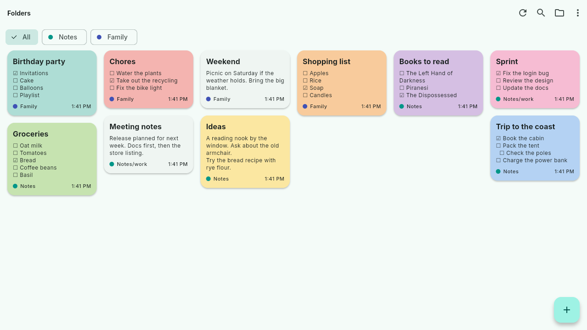

<p align="center">
  
</p>

<h1 align="center">Truce Editor</h1>

<p align="center">
  Your documents, shared between your devices and people,<br>
  with no server in the middle.
</p>

<p align="center">
  
</p>

## Why Truce

- **No central server.** Devices sync directly with each other, peer to
  peer, through [Syncthing](https://syncthing.net). There's no account to
  create and no cloud to trust: your files stay on your devices.
- **Works on any network, even offline.** Each device syncs with whichever
  others it can reach right now: at home, across the internet, or just over
  a private network or a phone's hotspot with no internet at all. As
  devices come and go, editing carries on.
- **Conflicts are caught, never lost.** When two devices change the same
  document at once, Truce notices, shows both versions side by side and lets
  you choose. Nothing is overwritten behind your back, and backups
  of the last 7 days let you go back.
- **Plain files you own.** Documents are ordinary Markdown or text files
  in your own folders. Truce rewrites only the block you edit (a paragraph, a
  heading, a list item), in the document's own style where it can;
  everything else stays exactly as it was, byte for byte, so documents
  stay readable by any other app.
- **Built on a trusted sync tool.** Syncthing does the syncing; Truce
  focuses on editing and conflicts. Support for other sync tools can follow.

## What it does today

- Markdown documents and checklists, edited visually (lists, styles,
  drag and drop), as raw Markdown, or read rendered.
- Plain text files (`.txt`), edited as text.
- As many folders as you like, subfolders included, each shared with its
  own devices and people: say one for you and one for the family shopping.
- Search, pins and colors across all of them.
- Undo and redo while editing, and backups of each document from the last
  7 days, to compare and restore.
- Android and Linux (Flatpak).

## What's coming

- Assisted merge: Truce suggests a merged version of a conflict for you to
  accept.
- More kinds of files beyond Markdown and plain text.
- Windows, macOS and iOS.

Truce is in early development (0.x), so expect changes between versions.

## Install

Grab the APK (Android) or the Flatpak (Linux) from the
[latest release](https://github.com/trucefiles/editor/releases/latest).
You need Syncthing running on your devices, with a shared folder for your
documents.

To check a download, compare it with `SHA256SUMS` from the same release.
The APK is signed with the key whose certificate SHA-256 is in
[`app/android/release-certificate-sha256.txt`](app/android/release-certificate-sha256.txt).

```sh
sha256sum --check --ignore-missing SHA256SUMS
flatpak install --user truce-editor-vX.Y.Z.flatpak
```

On Linux, `--background` starts Truce in the tray, e.g. at login, when
"Keep running in tray" is on in Settings:

```sh
flatpak run io.github.trucefiles.editor --background
```

## Features in pictures

See [docs/features.md](docs/features.md): screenshots of the main screens
and of each new feature.

## Markdown support

See [docs/markdown.md](docs/markdown.md) for what Truce follows from the
Markdown standard and where it differs.

## Known limitations

See [docs/known-limitations.md](docs/known-limitations.md).

## Contributing and security

Ideas, bug reports and pull requests are welcome: see
[CONTRIBUTING.md](CONTRIBUTING.md). Found a security issue? Please report
it privately, as described in [SECURITY.md](SECURITY.md).

## License

GPL-3.0-or-later. See [LICENSE](LICENSE).

## Development

A Dart pub workspace with these packages:

- `core`: files, sync-tool interfaces, conflict handling and an open
  document's file owner. Pure Dart, no UI, nothing specific to one sync
  tool or document type.
- `markdown`: Markdown documents, read into a doc tree, edited and
  written back block-exact, with the editor's owner. Pure Dart, no UI;
  uses core, which knows nothing of it.
- `plain_text`: plain text documents, edited as a whole text, with the
  editor's owner. Pure Dart, no UI; uses core, which knows nothing of it.
- `syncthing`: Syncthing's conventions behind core's interfaces. Pure Dart.
- `plain_folder`: folders no sync tool syncs, or one Truce doesn't know,
  behind core's interfaces. Pure Dart.
- `folders`: the folders the user adds, their files through each sync
  tool, and how their changes are followed. Pure Dart, no UI; uses core.
- `documents`: the documents in those folders, their drafts, settings,
  backups and conflicts, and the open document's page. Pure Dart, no UI;
  uses core and folders.
- `document_editor`: editing documents on super_editor (Visual edit,
  Markdown edit, plain text, Read). Flutter; uses core, documents,
  markdown and plain_text.
- `app`: the Flutter app (Android, Linux): screens, view models, platform
  code, and the wiring that picks the document types (`markdown`,
  `plain_text`) and sync tools (`syncthing`, `plain_folder`).
- `test_support`: test doubles shared by the packages' tests (a fake sync
  tool, an in-memory file store). Only a dev dependency.
- `editor_test_support`: helpers for the editor's widget tests, shared by
  the editor's and the app's tests. Only a dev dependency.
- `lints`: analyzer and lint settings shared by all packages.

Needs Flutter 3.47.7. From the repository root:

```sh
flutter pub get --enforce-lockfile
dart format .
flutter analyze --fatal-infos
(cd core && dart test)
(cd markdown && dart test)
(cd plain_text && dart test)
(cd syncthing && dart test)
(cd plain_folder && dart test)
(cd folders && dart test)
(cd documents && dart test)
(cd document_editor && flutter test)
(cd app && flutter test)
```
