# Features in pictures

Screenshots of Truce's main screens and of each new feature, newest
first. They show sample documents only.

## Recent, All and search

Home shows your most recent documents from every folder, pinned ones on
top. **Show all** opens every document, newest first or by name (by name,
under each subfolder), as cards or a list. Settings sets how many recent
documents home shows. Search looks through every folder, by title, text,
file and folder names.

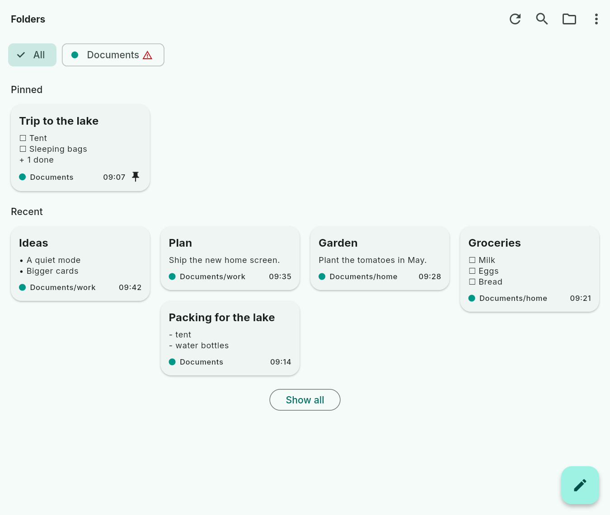
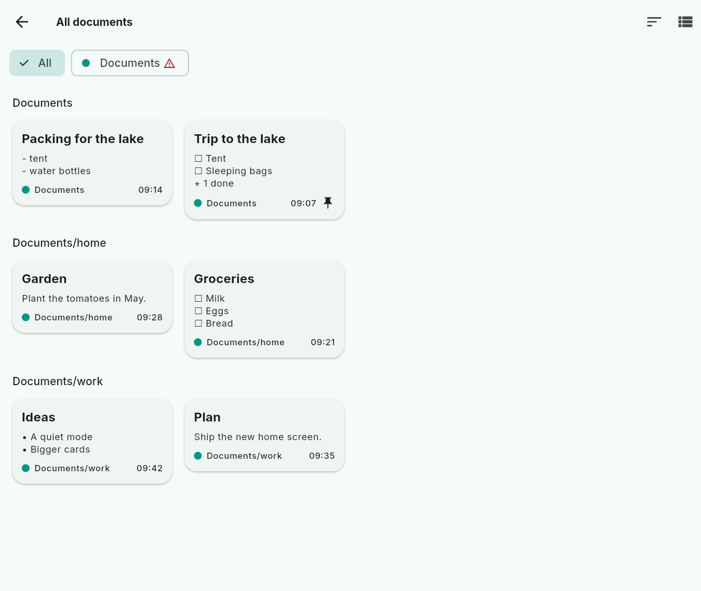
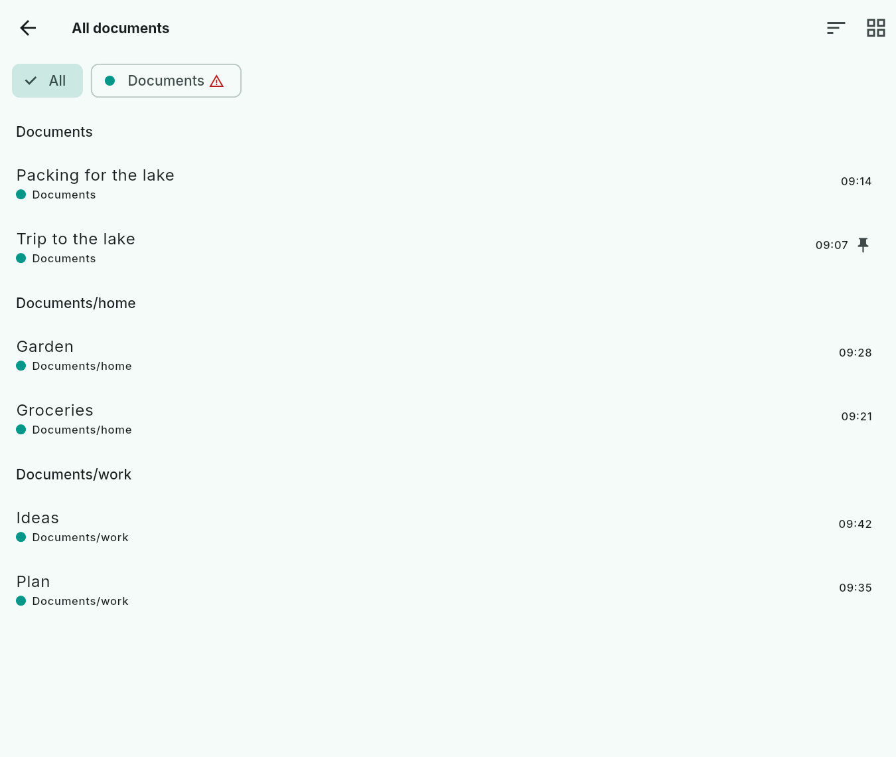
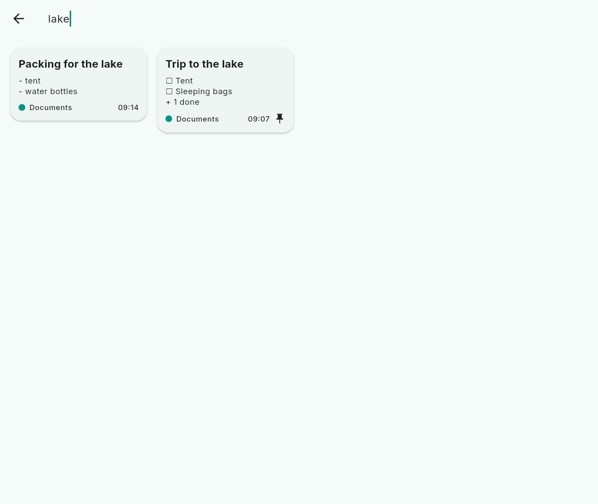

## Plain text files

Text files (`.txt`) show next to Markdown documents. A card shows the first
line as the title and the next lines below it. A text file opens in the same
page and is edited as written, with no styling: a `#` is just a character.
Undo, backups, compare and conflict copies work as for Markdown.

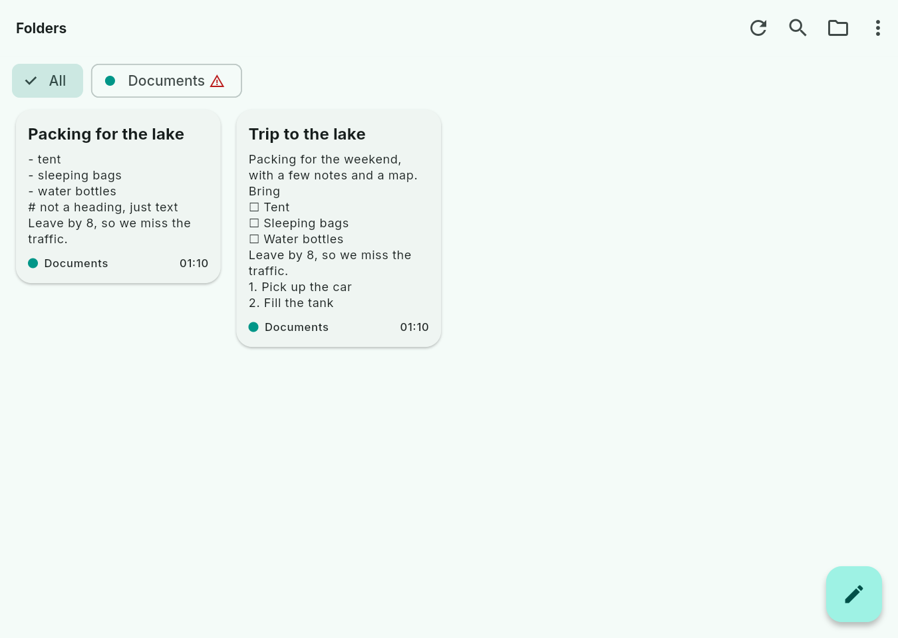
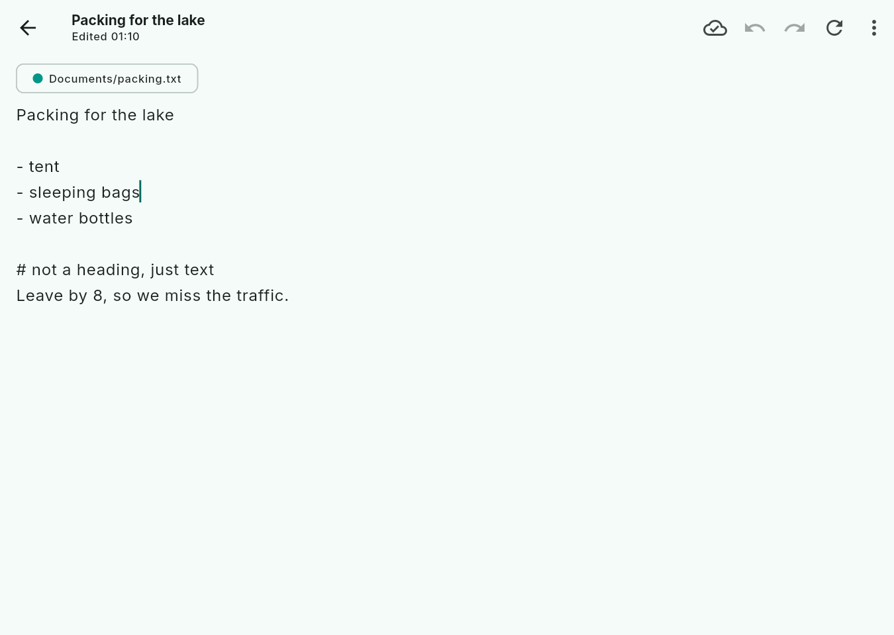

## Undo, redo and a document's backups

Undo and redo take back and redo your edits while a document is open, with
the buttons at the top or Ctrl+Z and Ctrl+Y. Once undo reaches the start, a
note says why and leads to the document's backups. The menu's **Backups**
lists only this document's backups: open one to compare it, then restore it
(Undo takes that back too) or delete it.

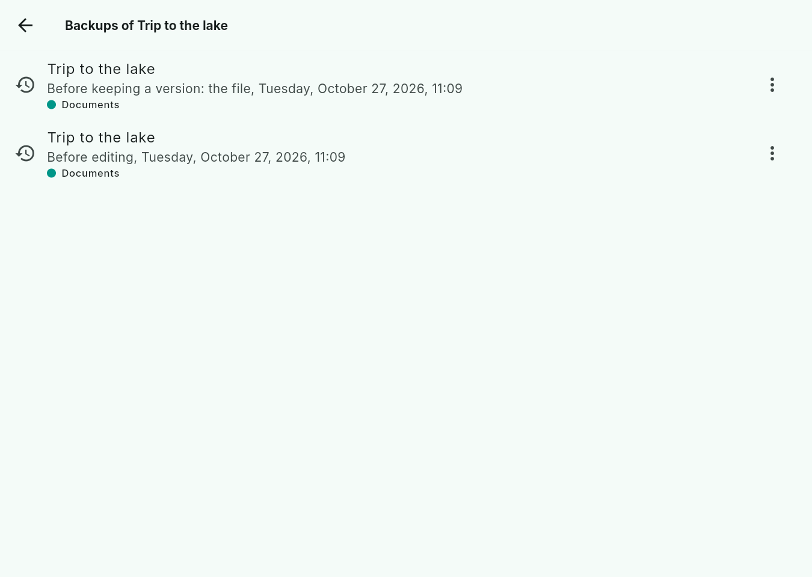
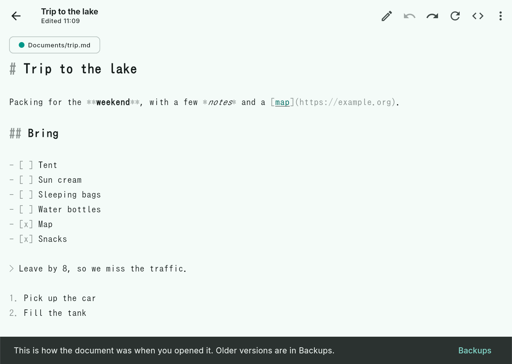

## Editing a document

The same document in each mode: **Visual edit** (lists, checkboxes, styles,
with the format bar), **Markdown edit** (every character, highlighted once
typing pauses) and **Read**, on the desktop and on a phone.

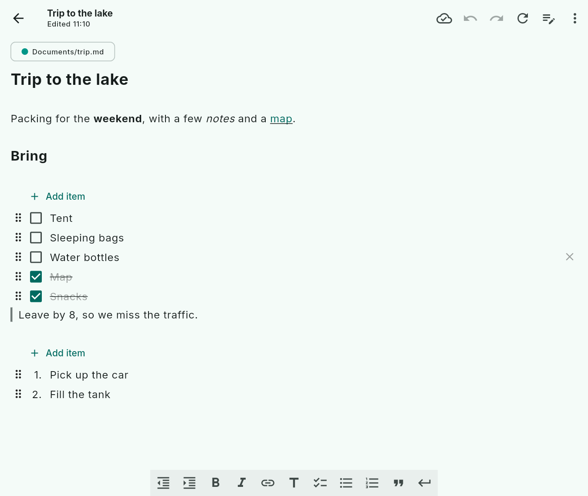
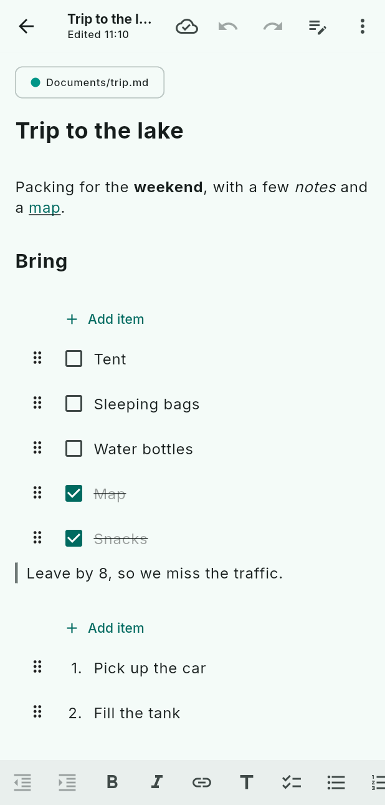

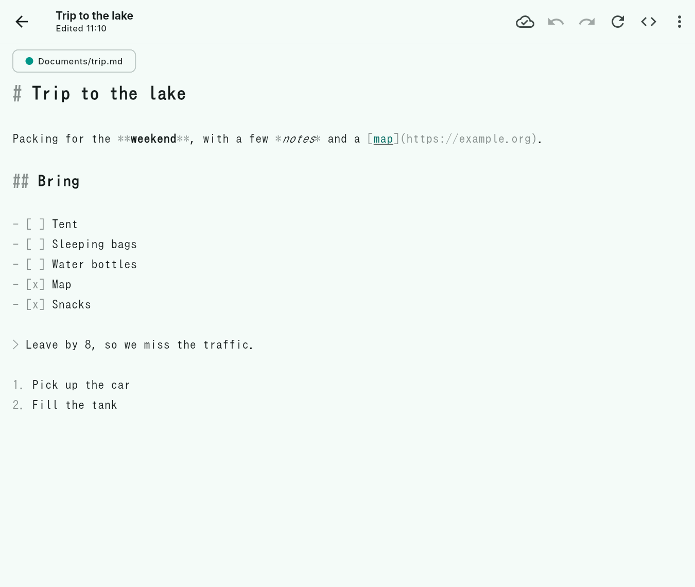
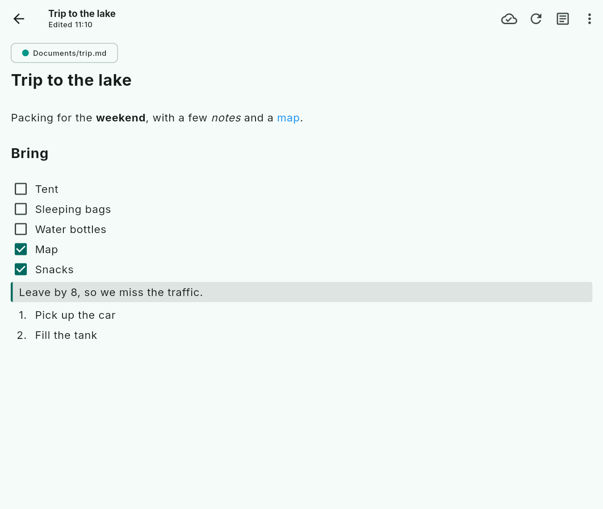
