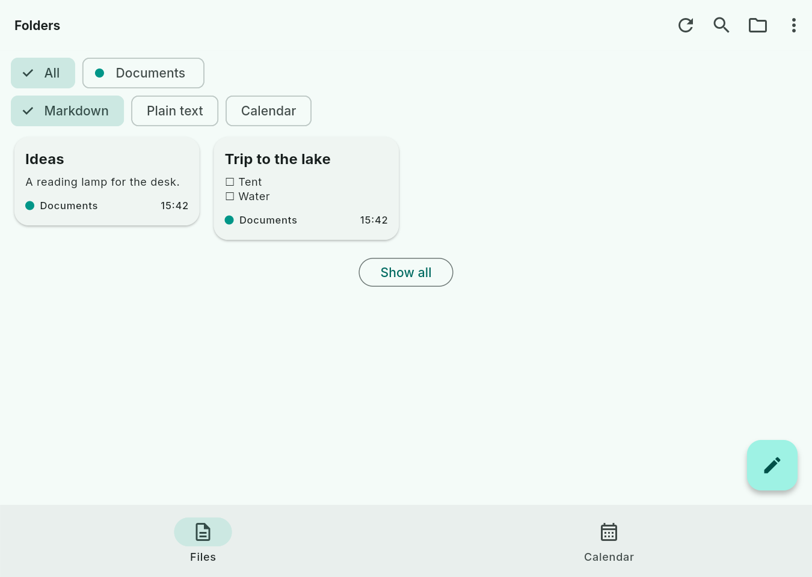
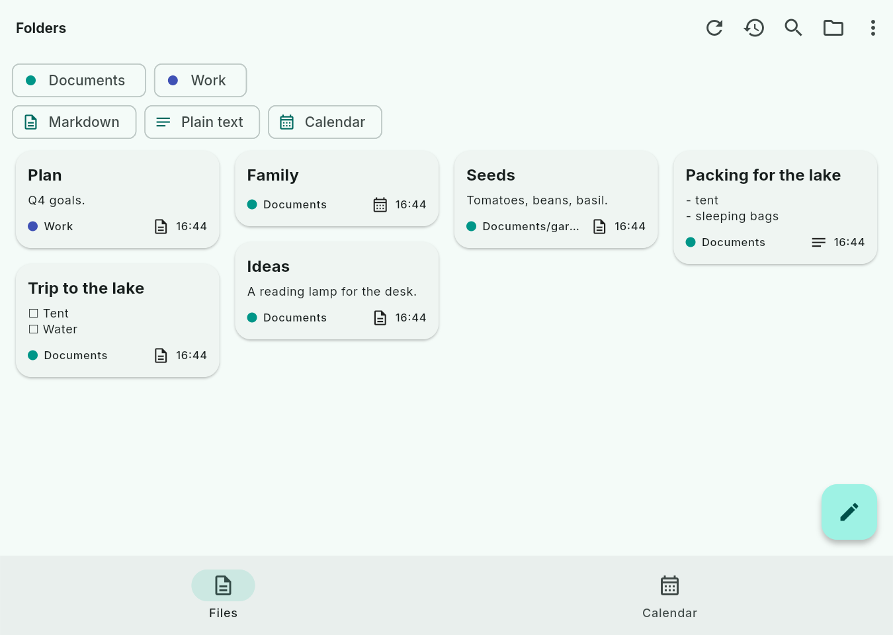

# Features in pictures

Screenshots of Truce's main screens and of each new feature, newest
first. They show sample documents only.

## Filter by file type

Below the folder chips, home and **Show all** have one chip per file
type: Markdown, Plain text and Calendar. Pick one to see only files of
that type; tap it again to see all. It works together with the folder
picked.

## Adding folders

**Add folder** first asks how the folder is synced: by Syncthing, or not
at all (a local folder). For Syncthing, pick any folder inside a
Syncthing folder: the app finds the Syncthing folder and shows its
folders, to tick each one to add. Each ticked one becomes a folder of its
own, with a name and a color.

## Calendars

Calendars are `.ics` files, the format other calendar apps use. **New
file** offers a calendar or a health calendar, named first. A
calendar's card shows its next events. Its page shows a month, a week,
a day or a schedule, the one you picked last. Tap a free time or day to
add an event there, or drag over a few hours; drag an event to move it,
or its edge to make it longer (for an event that repeats, that moves just
this one). Tap an event to edit or delete it, just this time or every
time. A health calendar keeps period days and other entries, and
estimates the next period. Once your folders hold a calendar, the
**Calendar** tab shows the events of all of them in the same views, each
in its folder's color. When two devices changed
the same calendar, the compare view offers **Merge both**: events merge
one by one, and where both changed the same event, the newer change is
kept.

## Recent, All and search

Home shows your most recent documents from every folder, pinned ones on
top. **Show all** opens every document, newest first or by name (by name,
under each subfolder), as cards or a list. Settings sets how many recent
documents home shows. Search looks through every folder, by title, text,
file and folder names.

## Plain text files

Text files (`.txt`) show next to Markdown documents. A card shows the first
line as the title and the next lines below it. A text file opens in the same
page and is edited as written, with no styling: a `#` is just a character.
Undo, backups, compare and conflict copies work as for Markdown.

## Undo, redo and a document's backups

Undo and redo take back and redo your edits while a document is open, with
the buttons at the top or Ctrl+Z and Ctrl+Y. Once undo reaches the start, a
note says why and leads to the document's backups. The menu's **Backups**
lists only this document's backups: open one to compare it, then restore it
(Undo takes that back too) or delete it.

## Editing a document

The same document in each mode: **Visual edit** (lists, checkboxes, styles,
with the format bar), **Markdown edit** (every character, highlighted once
typing pauses) and **Read**, on the desktop and on a phone.

